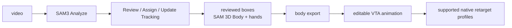

> **Current StudioFree MoCap checkpoint — 2026-11-09:** tentative name, shorthand
> MoCap; internal VTA identifiers retained. M1–M5 separation and UI Passes 1–5
> are locally deployed. Next is a fresh-clip end-to-end workflow, not a release.
> See [current status/roadmap](docs/current_status.md) and
> [current UI workflow](docs/vta_ui_workflow.md). Manual acceptance is partial.
> The BlendCap branding, marketing and paid-build links below are inherited
> upstream context, not the StudioFree MoCap release offer or supported feature list.

# BlendCap

### Markerless performance capture for Blender: video in, animation out.

---

This VTA integration reconstructs **body and hands** from ordinary video. Current VTA does not include facial capture/animation and does not require MediaPipe. Shared upstream existing-data/retarget helpers and attribution remain for compatibility; upstream marketing material is not a supported VTA feature list.

**VTA runtime update — 2026-10-23:** legacy **Run Capture / Run Preview** and
their detector-driven worker have been retired. The supported flow is
**SAM3 Analyze → Review/Assign → Update Tracking → reviewed reconstruction →
editable animation**. Ultralytics, THOP, HumanDetector and YOLO weights are not
required by this flow or included in its intended runtime requirements. Existing
local environments/models are not uninstalled or deleted. See the current
[VTA workflow guide](docs/vta_workflow.md). The inherited marketing, installer,
platform and generic-retarget material below is historical upstream context,
not a VTA 1.0 support or release claim.

> ### About this repository
>
> This is the **public source repository** for the BlendCap-derived VTA integration. The public integration remains GPL-3.0-or-later; see [Licensing](#licensing). The retired YOLO detector is no longer a runtime dependency.
>
> **Most people want the [paid build](#get-blendcap)**: it adds the one-click dependency installer, bundled model access so the setup just works, updates, and support. Building from this source yourself is possible but **advanced and unsupported**, there are no install scripts here by design; the requirements and model sources are documented in [`requirements.txt`](requirements.txt).

---

## Contents

- [Features](#features)
- [See it in action](#see-it-in-action)
- [Requirements](#requirements)
- [Get BlendCap](#get-blendcap)
- [Documentation](#documentation)
- [How it works](#how-it-works)
- [Roadmap](#roadmap)
- [Licensing](#licensing)
- [Acknowledgements](#acknowledgements)

---

## Features

- **Single-camera, markerless capture**: full body **and** hands from one ordinary clip.
- **Finger tracking**: both general hand shape tracking and full finger pose tracking, with dedicated controls to tune finger curl or rebuild the finger motion from the tracked keypoints.
- **Retarget onto your rig**: Rigify, Auto-Rig Pro, CloudRig, Mixamo and custom rigs, in both **FK and IK**, with included presets and a visual bone-map editor.
- **Capture cleanup built in**: foot grounding and locking, depth-noise filtering, smoothing, tracking-failure repair, and per-take camera-angle correction.
- **Runs fully offline** after setup, your footage never leaves your machine.
- **GPU-accelerated** on NVIDIA, with AMD/Intel paths that install automatically but aren't hardware-validated yet, and a CPU-only fallback.

## See it in action

| Body capture | Historical upstream demo (not included in VTA) |
|:---:|:---:|
|  |  |
| Ordinary clip → retargeted character | Historical face demo; no supported facial workflow |

|                      Retargeting                      |                    Post-processing                     |
| :---------------------------------------------------: | :----------------------------------------------------: |
|  |  |
|     Finished motion transferred to any other rig      | The clip's full post-processing pass, before and after |

|                 Finger tracking                 |          Historical upstream demo           |
| :---------------------------------------------: | :---------------------------------------------: |
|  |  |
|            Full finger pose tracking            |     Historical face demo; not supported in VTA      |

> **Watch the feature demo:** [YouTube](https://www.youtube.com/watch?v=hOW8U1goY8g)

## Requirements

| | |
|---|---|
| **Blender** | 4.2 or newer |
| **OS** | Windows 10/11 (fully supported) · Linux, including Flatpak Blender (supported) · macOS (not supported) |
| **GPU** | NVIDIA RTX 20 / GTX 16 series or newer, 6 GB+ VRAM recommended. AMD/Intel paths install automatically but aren't hardware-validated yet; CPU-only fallback available (slow). |
| **Disk / network** | ~32 GB free for models + dependencies; internet needed once for the ~11 GB setup download. Capture itself runs offline. |

See the full [system requirements](#documentation) in the documentation for the GPU tiers and the CPU-only fallback.

## Get BlendCap

The easiest way to use BlendCap is the **paid build**: install it in Blender and click once. It handles everything to get you up and running quickly and effortlessly:

- One-click dependency installer (no terminal, no manual Python)
- Bundled model access, so the ~11 GB setup just works
- Updates and support
- Validated on Windows and Linux with NVIDIA GPUs; AMD/Intel paths install automatically but aren't hardware-validated yet.

### → [**Get BlendCap on Gumroad**][store-link] ←
### → [**Also on Superhive (Blender Market)**][superhive-link] ←

[store-link]: https://arcomade.gumroad.com/l/BlendCap
[superhive-link]: https://superhivemarket.com/products/blendcap

## Documentation

Full documentation, installation, a first-capture quick start, every setting, and filming tips, lives in [`docs/`](docs/) in this repository, start at the [table of contents](docs/README.md).

The current reviewed multi-Character integration is described in the
[VTA public host workflow and technical guide](docs/vta_workflow.md).

## How it works

The body path runs Meta's **SAM 3D Body** with a **DINOv3** backbone and **MoGe** for camera field-of-view, using **Fast-SAM-3D-Body** on **PyTorch** / **ONNX Runtime**. MediaPipe is not an active runtime dependency.

Reviewed generation is routed through the public [job controller](blendcap/vta_jobs_ui.py), separated private orchestration/acceptance and the GPL [provider worker](blendcap_vta_provider_worker.py), using the detector-free model loader in [`save_mhr_data.py`](save_mhr_data.py). Shared export helpers live in [`pipeline/`](pipeline/) and FK math in [`blendcap/retarget/`](blendcap/retarget/). The legacy capture/preview planner and face-capture worker have been removed.

## Roadmap

The [current StudioFree MoCap roadmap](docs/current_status.md) starts with fresh-clip
end-to-end workflow testing. The inherited upstream directions below are historical
context, not current StudioFree MoCap implementation scope or release promises:

**Planned**
- **More rig presets** — ready-made bone maps for other popular rigs.
- **Smarter auto-match** — better automatic bone matching in the map editor, so custom rigs won't need as much manual input.
- **Multi-person capture** — track more than one performer in a shot and split them onto separate armatures.
- **Resumable captures** — pause and continue a long capture, and recover a crashed run instead of starting it over from scratch.

**Exploring**
- **Remote GPU capture** — run capture on your own cloud GPU when you don't have a local NVIDIA card ("bring your own pod").
- **Audio-assisted lip-sync** — use the clip's audio to sharpen mouth shapes during speech.
- **Dedicated hand capture** — prospective closer-view hand detail; not a separate facial-capture workflow.

## Licensing

BlendCap is licensed **GPL-3.0-or-later**. © 2026 Arcomade. See [`LICENSE`](LICENSE) and [`NOTICE.txt`](NOTICE.txt).

The 2026-10-23 cleanup removes Ultralytics, THOP and YOLO weights from the intended
VTA runtime payload. This does not change the public integration's GPL license,
remove historical notices, or resolve the separate Blender/private-core boundary
and model/native-runtime redistribution questions. No release/installer is certified
by this source cleanup.

Bundled / redistributed components keep their own licenses; full texts are in [`licenses/`](licenses/):

| Component | Role | License |
|---|---|---|
| Meta SAM 3D Body | Body + hand model | Meta SAM License |
| Meta DINOv3 | Vision backbone | Meta DINOv3 License |
| Ultralytics YOLO11 / THOP | Historical attribution only; retired from intended VTA runtime | AGPL-3.0 |
| Fast-SAM-3D-Body | Accelerated inference | MIT (over Meta-SAM code) |
| MoGe (Microsoft) | Camera field-of-view | MIT (+ Apache-2.0 subcomponent) |
| MediaPipe (Google) | Retained legacy attribution, not a VTA runtime dependency | Apache-2.0 |
| ICT-FaceKit (USC ICT) | Face expression basis (derived data asset) | MIT |
| PyTorch / ONNX Runtime | Runtimes | BSD-3-Clause / MIT |

> The **animation you create** with BlendCap is yours to use, including commercially. The SAM License permits commercial use royalty-free; you're responsible for having the rights to the footage you capture.

## Acknowledgements

BlendCap stands on the work of these projects and the teams behind them:

- [SAM 3D Body](https://github.com/facebookresearch/sam-3d-body) (Meta)
- [DINOv3](https://github.com/facebookresearch/dinov3) (Meta)
- [Fast-SAM-3D-Body](https://github.com/yangtiming/Fast-SAM-3D-Body)
- [YOLO11 / Ultralytics](https://github.com/ultralytics/ultralytics)
- [MoGe](https://github.com/microsoft/MoGe) (Microsoft)
- [MediaPipe](https://github.com/google-ai-edge/mediapipe) (Google)
- [ICT-FaceKit](https://github.com/USC-ICT/ICT-FaceKit) (USC Institute for Creative Technologies)
- [PyTorch](https://pytorch.org/) · [ONNX Runtime](https://onnxruntime.ai/)
- …and [Blender](https://www.blender.org/) and its community.
